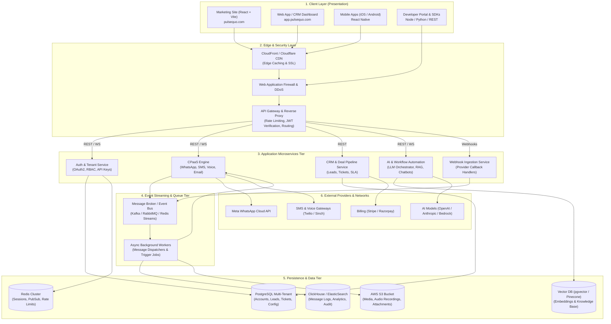
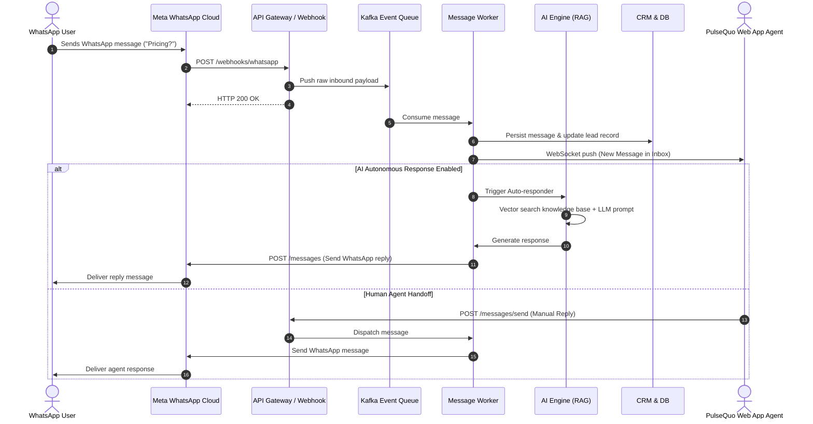

# PulseQuo — Client-Server Architecture & Engineering Specification

This document details the end-to-end technical architecture for the **PulseQuo** AI & CPaaS platform, spanning client applications, edge routing, microservices, messaging pipelines, and persistence layers.

---

## 1. High-Level System Architecture

---

## 2. Architectural Layers Breakdown

### A. Client Layer (Presentation & SDKs)
* **Marketing Website (`pulsequo.com`)**:
  * Built with React 19, Vite 8, TypeScript, and Tailwind CSS 4.
  * Static asset optimization, automated OpenGraph/Twitter meta tags, and structured JSON-LD schemas.
  * Client-side form validation submitting to public endpoints (`/api/public/demo-requests`, `/api/public/contact`).
* **PulseQuo Web Application (`app.pulsequo.com`)**:
  * Real-time Single Page Application (SPA) dashboard.
  * **State Management**: Server caching with TanStack Query + client state via Zustand.
  * **Real-time Engine**: WebSocket client connection for incoming omnichannel conversations, lead updates, and notifications.
* **Mobile & SDKs**:
  * React Native mobile client for agents handling customer conversations on the move.
  * REST API SDKs (Node.js, Python, Go) for external developer integrations.

---

### B. Edge, CDN & API Gateway Layer
* **CDN & Edge Cache**: AWS CloudFront handles edge caching, HTTP/3, and SSL termination.
* **Security & DDoS**: AWS WAF inspects traffic for SQL injection, XSS, and IP-based rate abuses.
* **API Gateway (Kong / Envoy / AWS API Gateway)**:
  * **Authentication**: Decodes and verifies RS256 JWT tokens or Developer API Keys (`pq_live_...`).
  * **Rate Limiting**: Redis-backed token bucket algorithm per IP and per tenant.
  * **Routing**: Maps request routes (`/api/v1/messages/*`, `/api/v1/crm/*`, `/api/v1/ai/*`) to downstream microservices.

---

### C. Microservices Application Tier
Each microservice is containerized (Docker / Kubernetes) and stateless:

1. **Authentication & Tenant Service**:
   * Handles tenant provisioning, user registration, role-based access control (RBAC), and team permission policies.
2. **CPaaS & Omnichannel Messaging Service**:
   * Bridges unified messaging protocols across WhatsApp Business API, SMS (Twilio, Gupshup), Email (SendGrid), and Voice.
   * Standardizes inbound and outbound messages into a canonical `ChatMessage` structure.
3. **Sales & Support CRM Service**:
   * Manages customer profiles, interaction timelines, ticket queues, SLA deadlines, and deal pipelines.
4. **AI & Workflow Automation Engine**:
   * Executes visual workflow logic (triggers, conditions, automated actions).
   * Orchestrates LLM queries with Retrieval-Augmented Generation (RAG) using tenant-specific knowledge bases.
5. **Webhook Ingestion Engine**:
   * High-throughput endpoint handling callbacks from Meta (WhatsApp message delivery receipts), telcos, and payment providers.
   * Immediately acknowledges (HTTP 200) and offloads payload processing to the message broker.

---

### D. Event Streaming & Persistence Tier
* **Message Broker (Apache Kafka / Redis Streams)**:
  * Decouples synchronous API requests from long-running tasks (broadcast campaigns, batch SMS, AI inference).
* **Primary Relational DB (PostgreSQL)**:
  * Houses structured data: accounts, users, leads, tickets, pipelines, and billing data with row-level tenant isolation (`tenant_id`).
* **Cache & In-Memory Store (Redis Cluster)**:
  * User session tokens, active WebSocket connection tables, real-time agent presence, and rate limit counters.
* **Vector Database (pgvector / Pinecone)**:
  * Vector embeddings of tenant FAQs, support articles, and documents for the AI copilot and self-serve chatbots.
* **Analytics & Log Store (ClickHouse)**:
  * High-volume communication logs, message delivery status receipts (DLRs), click tracking, and billing analytics.
* **Object Storage (AWS S3)**:
  * Stores media attachments, voice call recordings, invoices, and customer documents.

---

## 3. Key End-to-End Interaction Flow

---

## 4. Client-to-Server Communication Protocols

| Interface | Protocol | Transport | Purpose |
| :--- | :--- | :--- | :--- |
| **Public API** | RESTful / JSON | HTTPS (TLS 1.3) | Lead capture, demo bookings, developer endpoints |
| **Real-time Live Inbox** | WebSocket / WSS | TCP / WSS | Instant agent messaging, typing indicators, active ticket status |
| **Telemetry / Logs** | Server-Sent Events (SSE) | HTTP/2 | Streaming AI token responses, campaign progress bars |
| **Internal Microservices** | gRPC / Protocol Buffers | HTTP/2 | High-speed, low-latency inter-service communication |
| **Event Pipeline** | Kafka Protocol | TCP | Ingestion of webhooks, message logs, and worker jobs |

---

## 5. Multi-Tenancy & Security Architecture

1. **Logical Tenant Separation**: Every query to PostgreSQL is bound to an authenticated `tenant_id` via application-level scoping or Postgres Row-Level Security (RLS).
2. **Encryption Standards**:
   * **In-Transit**: TLS 1.3 on all client-to-edge and edge-to-service connections.
   * **At-Rest**: AES-256 encryption on databases, Redis clusters, and S3 buckets.
3. **Resilience & Scaling**:
   * Horizontal pod autoscaling (HPA) for compute services based on CPU/memory and queue lag.
   * Multi-AZ database deployment with read replicas to handle reporting queries without degrading transactional performance.

